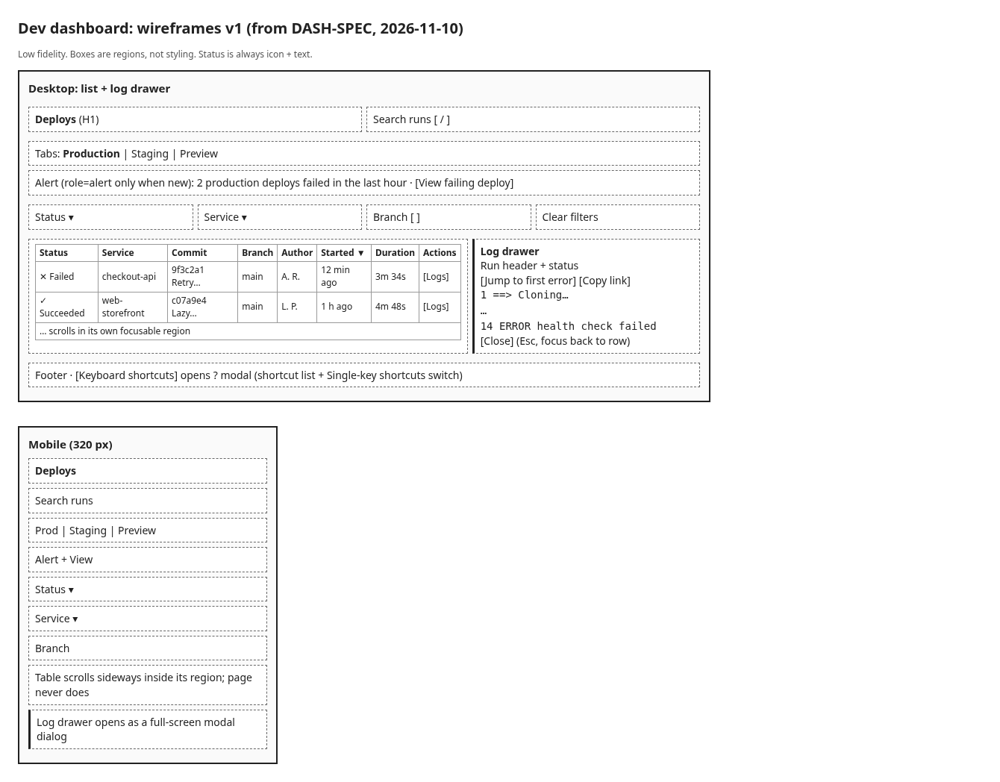
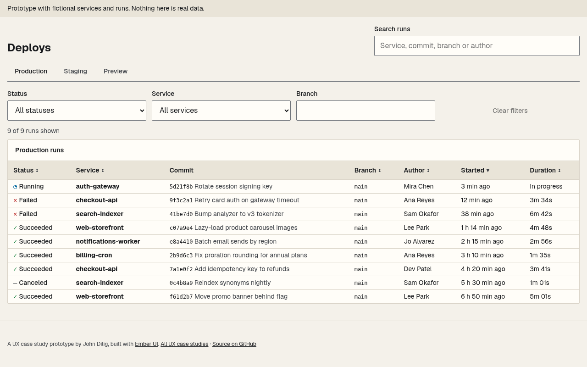
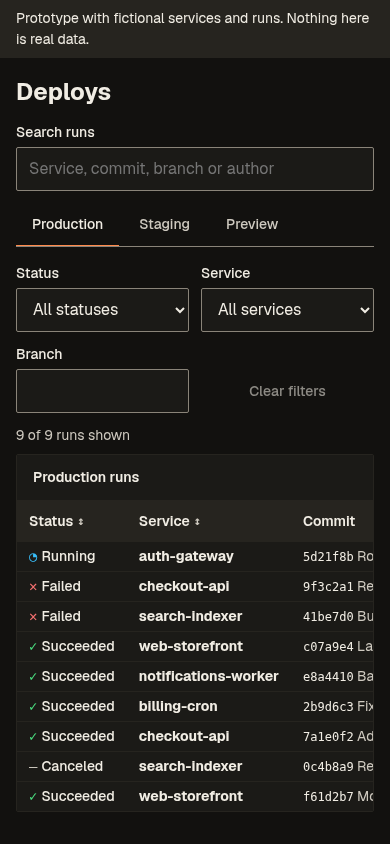
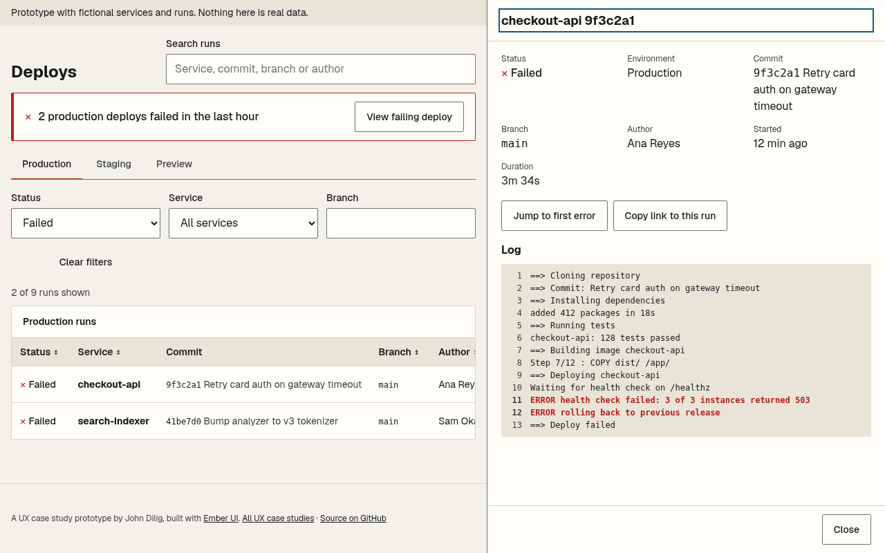
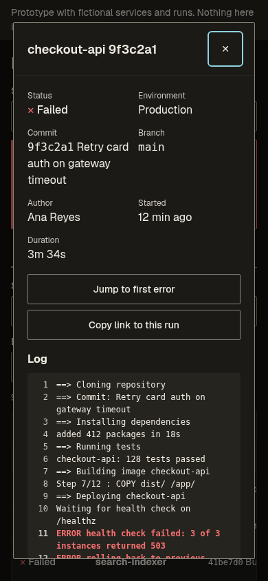
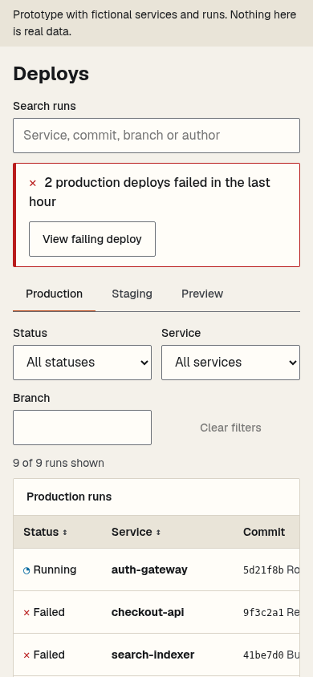

# Progress log: devtool-dashboard

UX project 3 of 3. Persona, tasks and flows come from the design spec (Chief of Creatives); the persona is an **assumption**, not research.

## Design log (Chief of Creatives)
- 2026-11-10 - Project picked as UX project 3 of 3.
- 2026-11-10 - Assumption persona: on-call engineer paged mid-task. Top 3 tasks: is anything failing, what changed, show me the logs.
- 2026-11-10 - Flows v1 incl. keyboard path (/ search, f filters, j/k rows, Enter log, Esc back with focus return).
- 2026-11-10 - Layout v1: env tabs, alert banner, filter bar, dense table, log drawer. Decision: status always icon + text, never color alone.
- 2026-11-10 - R-7 (WCAG 2.1.4): single-key shortcuts get an off switch in the shortcuts dialog, and never fire inside inputs.

## Build log
### 2026-11-10 - Wireframe
Low-fidelity wireframes for desktop and 320 px mobile, drawn from the spec ([source](docs/wireframes/wireframes.html)).

### 2026-11-10 - Prototype 1: runs list
- Vite + React + TypeScript, Ember UI pinned to `github:balbonits/a11y-design-system#v0.2.2` (no source alias).
- 24 fictional runs across Production, Staging and Preview, including failures, a running deploy and cancellations.
- Environment tabs, search, Status/Service/Branch filters in the URL, sortable dense table, loading, error, no-results and all-green states.
- Styles use Ember tokens only; a token lint in CI blocks `@keyframes`, literal colors and hardcoded shape values.
- Checks: 13 unit and component tests; axe sweep of 8 states at 1280/900/414/375/320 px in light and dark with reduced motion: 0 serious or critical, no page-level horizontal overflow, every control at least 44 px.

| Desktop | Mobile, dark |
|---|---|
|  |  |

More: [failed filter](docs/screenshots/2026-11-10-prototype-failed-filter.png), [no results](docs/screenshots/2026-11-10-prototype-no-results.png), [all green](docs/screenshots/2026-11-10-prototype-all-green.png), [error on mobile](docs/screenshots/2026-11-10-prototype-error-mobile.png).

### 2026-11-10 - Prototype 2: log drawer, alert banner, run links
- Each row has a Log button. Its run opens at `#/run/<id>`, so a run is linkable, Back closes it, and a stale link shows "Run not found".
- At 1024 px and wider the log is a side panel and the list stays usable; below that it is Ember's modal dialog.
- The drawer shows the run facts, a numbered log, Jump to first error (moves focus to the first ERROR line) and Copy link to this run (toast on success or failure).
- R-5: opening a run sets the title to "{service} {sha} · Run log · Deploys" and moves focus to the panel heading (the dialog's first control on mobile). Closing with Close, Esc or Back restores the list title and returns focus to that run's Log button, falling back to the H1, with the list's scroll position kept.
- Alert banner: "{n} production deploys failed in the last hour" with View failing deploy, which switches to Production, filters to failed runs of that service and opens the newest. It is announced as an alert only the first time a given set of failures appears in a session.
- Checks: 21 unit and component tests; axe sweep now covers 11 states including the open drawer and a missing run (0 serious or critical, no overflow, all controls 44 px+); new browser e2e (`npm run test:e2e`) runs the R-5 and drawer checks on desktop and mobile.
- Secret scan: gitleaks 8.28.0 now runs in CI over the full history on every PR and push to main (`.github/workflows/gitleaks.yml`).
- Ember gap found: at 320 px a long modal title squeezed the dialog's close button to 42 px. Patched in this app's CSS and reported for Ember.

| Log drawer, desktop | Log dialog, mobile dark | Alert banner, mobile |
|---|---|---|
|  |  |  |

## Not done yet
Keyboard shortcuts and their off switch (R-7), ACR, keyboard and screen-reader pass, making the repo public, BUILD.json and the jdilig.me case study.
