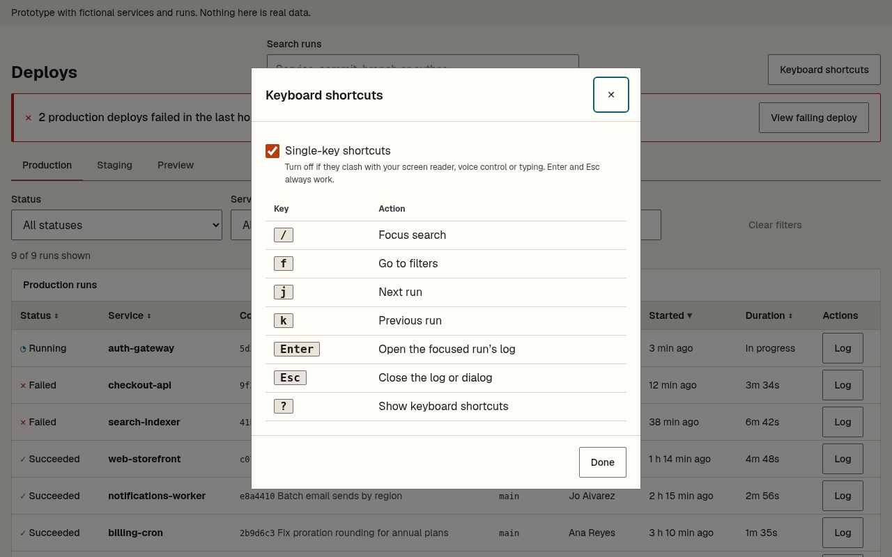
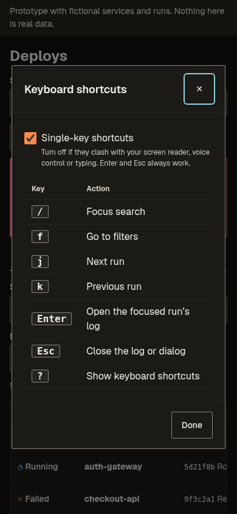

# Progress log: devtool-dashboard

UX project 3 of 3. Persona, tasks and flows come from the design spec (Chief of Creatives); the persona is an **assumption**, not research.

## Design log (Chief of Creatives)
- 2026-11-10 - Project picked as UX project 3 of 3.
- 2026-11-10 - Assumption persona: on-call engineer paged mid-task. Top 3 tasks: is anything failing, what changed, show me the logs.
- 2026-11-10 - Flows v1 incl. keyboard path (/ search, f filters, j/k rows, Enter log, Esc back with focus return).
- 2026-11-10 - Layout v1: env tabs, alert banner, filter bar, dense table, log drawer. Decision: status always icon + text, never color alone.
- 2026-11-10 - R-7 (WCAG 2.1.4): single-key shortcuts get an off switch in the shortcuts dialog, and never fire inside inputs.

## Build log
### 2026-11-10 - Wireframe
Low-fidelity wireframes for desktop and 320 px mobile, drawn from the spec ([source](docs/wireframes/wireframes.html)).

### 2026-11-10 - Prototype 1: runs list
- Vite + React + TypeScript, Ember UI pinned to `github:balbonits/a11y-design-system#v0.2.2` (no source alias).
- 24 fictional runs across Production, Staging and Preview, including failures, a running deploy and cancellations.
- Environment tabs, search, Status/Service/Branch filters in the URL, sortable dense table, loading, error, no-results and all-green states.
- Styles use Ember tokens only; a token lint in CI blocks `@keyframes`, literal colors and hardcoded shape values.
- Checks: 13 unit and component tests; axe sweep of 8 states at 1280/900/414/375/320 px in light and dark with reduced motion: 0 serious or critical, no page-level horizontal overflow, every control at least 44 px.

| Desktop | Mobile, dark |
|---|---|
|  |  |

More: [failed filter](docs/screenshots/2026-11-10-prototype-failed-filter.png), [no results](docs/screenshots/2026-11-10-prototype-no-results.png), [all green](docs/screenshots/2026-11-10-prototype-all-green.png), [error on mobile](docs/screenshots/2026-11-10-prototype-error-mobile.png).

### 2026-11-10 - Prototype 2: log drawer, alert banner, run links
- Each row has a Log button. Its run opens at `#/run/<id>`, so a run is linkable, Back closes it, and a stale link shows "Run not found".
- At 1024 px and wider the log is a side panel and the list stays usable; below that it is Ember's modal dialog.
- The drawer shows the run facts, a numbered log, Jump to first error (moves focus to the first ERROR line) and Copy link to this run (toast on success or failure).
- R-5: opening a run sets the title to "{service} {sha} · Run log · Deploys" and moves focus to the panel heading (the dialog's first control on mobile). Closing with Close, Esc or Back restores the list title and returns focus to that run's Log button, falling back to the H1, with the list's scroll position kept.
- Alert banner: "{n} production deploys failed in the last hour" with View failing deploy, which switches to Production, filters to failed runs of that service and opens the newest. It is announced as an alert only the first time a given set of failures appears in a session.
- Checks: 21 unit and component tests; axe sweep now covers 11 states including the open drawer and a missing run (0 serious or critical, no overflow, all controls 44 px+); new browser e2e (`npm run test:e2e`) runs the R-5 and drawer checks on desktop and mobile.
- Secret scan: gitleaks 8.28.0 now runs in CI over the full history on every PR and push to main (`.github/workflows/gitleaks.yml`).
- Ember gap found: at 320 px a long modal title squeezed the dialog's close button to 42 px. Patched in this app's CSS and reported for Ember.

| Log drawer, desktop | Log dialog, mobile dark | Alert banner, mobile |
|---|---|---|
|  |  |  |

### 2026-11-10 - Prototype 3: keyboard shortcuts with an off switch (R-7)
- `/` search, `f` filters, `j`/`k` next and previous run, Enter opens the focused run's log, Esc closes, `?` opens the shortcuts dialog. A visible Keyboard shortcuts button in the header opens the same dialog.
- WCAG 2.1.4: a "Single-key shortcuts" checkbox in the dialog turns the single keys off. It is on by default and saved in localStorage under a versioned key; if storage is blocked it falls back to on and keeps the choice for the session. Enter and Esc always work.
- Single keys never fire in an input, select, textarea or contenteditable, with Ctrl, Alt or Meta held, or while a dialog is open. The page has no `role=application`, and each control carries its key in `aria-keyshortcuts`; `/` and `f` find their target by that attribute, so the two can't drift.
- The dialog's list is rendered from the same key map the handler uses, and a test checks both. Uses Ember's Checkbox for now; it moves to Ember's Switch when v0.3.1 ships, as a follow-up.
- Checks: 26 unit and component tests; e2e adds the R-7 cases (typing j in search, j/k/Enter on rows, everything off after a reload, header button still works) and an axe run on the open dialog; the axe sweep is unchanged at 0 failing.

| Shortcuts dialog, desktop | Mobile, dark |
|---|---|
|  |  |

### 2026-11-10 - Accessibility report and checks
- Added [docs/ACR.md](docs/ACR.md), a self-assessed VPAT 2.5 Rev 508 report covering WCAG 2.0, 2.1 and 2.2 A/AA. 302.1 Without Vision is Partially Supports until a screen-reader pass is done.
- New check: the axe script now also applies the WCAG 1.4.12 text-spacing styles at 640 px (1280 at 200% zoom) and 320 px and looks for overflow and clipped text (22 runs, 0 failing). The e2e now checks the skip link too.
- Fix: the normal and all-green views now render the mock data on first paint, rather than showing the skeleton for 300 ms. Lighthouse had measured a layout shift of 0.375 from the skeleton swap. The loading and error previews still use `?state=`.
- Lighthouse 13.6 on the local build, mobile and desktop: accessibility 100 and best practices 100 on the list, an open run log and the error state. Performance is 100 on the list and run log, and 99 to 100 on the error state.
- Keyboard pass: scripted in `scripts/e2e.mjs` (Chrome, Linux), all checks pass. **Screen reader: not run yet.** No screen reader is installed on the build machine, so no reader pass is claimed.

## Not done yet
Screen-reader pass, making the repo public, a release tag, BUILD.json and the sync into jdilig.me, and the case study.
ACR, keyboard and screen-reader pass, making the repo public, BUILD.json and the jdilig.me case study.
Keyboard shortcuts and their off switch (R-7), ACR, keyboard and screen-reader pass, making the repo public, BUILD.json and the jdilig.me case study.
Log drawer, alert banner, run links with title/focus/scroll handling (R-5), keyboard shortcuts and their off switch (R-7), ACR, keyboard and screen-reader pass, secret scan, BUILD.json and the jdilig.me case study.

## 2026-11-10 ~7:00 PM PT: review fixes (QA FAIL on 6a2cc73)
- Shape tokens now use only the locked R-2 names: `--radius-sm` (skip link) and `--radius-md` (calm note, banner). Ember v0.2.2 doesn't ship those yet, so corners stay square until v0.3.0. `--border-width` and `--target-min` keep a fallback until then.
- Loading now matches DASH-SPEC line 31: the table is in place with `aria-busy="true"`, its skeleton rows are `aria-hidden`, one polite status says "Loading runs", and nothing animates. The real table replaces it when data lands.
- token-lint also fails on retired token names (exact match, so `--focus-ring-color` still passes), with tests that plant each one.
- Checks: 26 unit tests (12 of them token-lint), token-lint clean, axe 80 runs with 0 failing.

## 2026-11-10 ~8:00 PM PT: Chief Architect follow-ups before the ACR
- The failure banner's alert region mounts with its text hidden and fills it in about 50 ms later, so screen readers notice the new text. The text keeps its space while hidden, so nothing shifts (Lighthouse layout shift stays 0.018).
- The "n of m runs shown" count changes on screen at once, but the status that screen readers hear waits until filtering has settled for about 500 ms.
- With single-key shortcuts off, no control advertises them in `aria-keyshortcuts` any more.
- e2e waits for the mobile log dialog to finish closing before pressing `?`; that race had made one run in three fail.
- Checks: 41 unit and component tests; token-lint clean; axe 110 runs and the text-spacing pass, 0 failing; e2e passed 3 runs in a row; Lighthouse on the list: accessibility, best practices and performance 100, layout shift 0.018.

## 2026-11-10 6:30 PM PT: sign-offs and follow-ups
- Chief Architect signed the ACR. At CA's request, 4.1.3 now says Partially Supports until a screen-reader pass, matching 302.1.
- QA nit fixed: shortcuts now ignore every editable element, `contenteditable="plaintext-only"` included (new unit test).
- Tracked follow-up (EMBER-030): the PR that adopts Ember v0.3.0 removes the `var(--border-width, 1px)` and `var(--target-min, 44px)` fallbacks and checks the now-rounded corners.
- At release, the ACR Version line names the deployed commit SHA.

## 2026-11-10: Design: kinetic identity (UX/UI Designer)
Kinetic (Kinetic Swiss) is this app's v3 identity on Ember UI, designed in balbonits/a11y-design-system. Times are merge times in PT, from GitHub.
- 5:29 PM PT: direction D kinetic lands on main, with the prototype, tokens, TOKENS.md, CONTRAST.md, screenshots at 375 and 1280, a first HANDOFF.md and the shared v3 tooling ([PR #9](https://github.com/balbonits/a11y-design-system/pull/9), `dd99b4b`).
- 5:59 PM PT: HANDOFF rewritten in the neo format, with annotated screenshots ([PR #14](https://github.com/balbonits/a11y-design-system/pull/14), `96b1fe2`).
- 6:01 and 6:08 PM PT: Chief of Creatives' scope rulings recorded in the HANDOFF ([PR #18](https://github.com/balbonits/a11y-design-system/pull/18), `983ec14`), then kept in the HANDOFF source ([PR #19](https://github.com/balbonits/a11y-design-system/pull/19), `202b5da`).
- 6:36 PM PT: rework into the dev dashboard Deploys page, with the "App: dev dashboard" block for Front End Developer and Addendum 7's `--scrim` and `--radius-xl` ([PR #20](https://github.com/balbonits/a11y-design-system/pull/20), `938e642`).
- Chief Architect signed kinetic at `938e642`, and Visual QA passed it at the same sha.
- 6:48 PM PT: Known issue 6 RULED by Chief Architect: the log drawer is a modal dialog at every width ([PR #22](https://github.com/balbonits/a11y-design-system/pull/22), `eec5773`).
- 7:24 PM PT: v3 README entry page for all three directions ([PR #28](https://github.com/balbonits/a11y-design-system/pull/28), `1835b93`).
- Live prototype: [kinetic Deploys page](https://raw.githack.com/balbonits/a11y-design-system/main/docs/directions/v3/kinetic/index.html). Spec: [kinetic HANDOFF](https://github.com/balbonits/a11y-design-system/blob/main/docs/directions/v3/kinetic/HANDOFF.md).
- Next: the app build, by Front End Developer on `feat/kinetic-theme`, after Ember v0.3.1 (planned, not released).

## 2026-11-11: Kinetic on Ember main (Front End Developer, PR #5)
- `ember-ui` is pinned to Ember main `2d59d7b9d00b636f3a2bf88bbcebebb5382f43b9` (v0.3.1 content, no tag): kinetic registered, HIT-PATCH #36, and the toast modal outlet #51. `src/styles/kinetic-shim.css` is deleted; every token comes from Ember's kinetic theme.
- Merged devtool-dashboard main (`1d862be`) in. The run log is a modal dialog at every width (RunDrawer is folded into RunDialog), and Copy link reports through an in-dialog status line, per Chief Architect's #9 ruling, instead of a toast.
- Buttons use Ember's kinetic hover (inverted fill) and press offset; the local overrides are gone. The `.em-tab` KNOWN_GAPS entry and the `.em-btn--sm::before` override are removed (DASH-EMBER-V03 folded in), and ACR 2.5.8 now reads "every standalone control meets the project's 44px goal".
- The metric-matched fallback font faces are dropped, because Ember's kinetic stacks don't name them. Flagged in the PR as a possible font-swap layout shift question.
- New `scripts/kinetic-contrast.mjs`: 21 text and UI pairs in light and dark from Ember's built CSS, 42 checks, 0 under their threshold.
- Gates: lint 0, typecheck, vitest 49/49, build, e2e 219/0 (targets 44px+ at 320 and 1280 in every state), a11y 416 checks / 0 failing (axe 208 runs, 200% zoom 130, text spacing 78).
- Before (main on v0.2.2) and after side-by-sides are in `docs/shots/kinetic/`.
